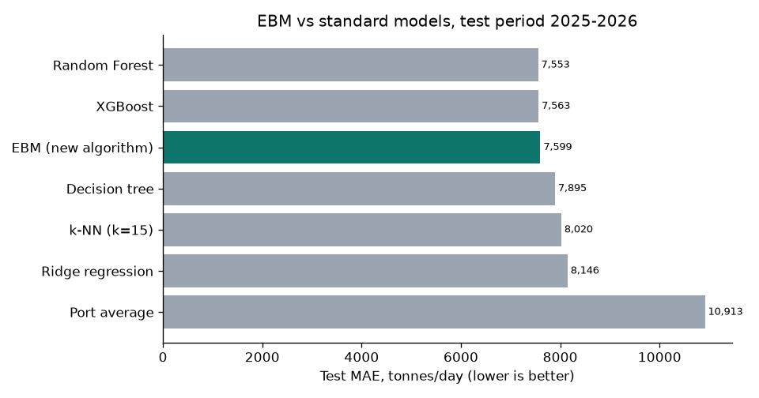

# Port Cargo XAI: an Explainable Boosting Machine for Sri Lankan ports

This project estimates the **daily import cargo (tonnes)** at Colombo, Hambantota, Trincomalee and Galle from the vessel calls expected each day.

The model is an **Explainable Boosting Machine (EBM)**, a glass-box algorithm. It is explained with its own exact contributions, plus SHAP, LIME, PDP/ICE and permutation importance, and served through a FastAPI service and a Streamlit front end.

The project is versioned with **uv, DVC, MLflow (DagsHub) and GitHub Actions**, following the course MLOps workshop. There are no containers.

| | |
|---|---|
| Data | IMF PortWatch, *Sri Lanka daily port activity data and shipment estimates*: 11,048 port-days, 2019-01-01 to 2026-07-24 (public, aggregated, no personal data) |



## Results (test set 2025-01-01 to 2026-07-23)

| Model | MAE (t/day) | RMSE | R² |
|---|---:|---:|---:|
| Random Forest | 7,553 | 15,959 | 0.705 |
| XGBoost | 7,563 | 15,904 | 0.707 |
| **EBM (new algorithm, glass box)** | **7,599** | **15,780** | **0.711** |
| Decision tree | 7,895 | 16,610 | 0.680 |
| k-NN (k = 15) | 8,020 | 16,670 | 0.678 |
| Ridge regression | 8,146 | 16,164 | 0.697 |
| Port average | 10,913 | 20,229 | 0.526 |

The EBM is within 0.6% of the black-box models and has the best R². Each of its predictions breaks down exactly into feature contributions.

## Quick start

**Windows:** double-click `run_local.bat`. It installs uv and the packages, gets or builds the model, and opens http://localhost:8501.

**Codespaces / Linux / Mac:**

```bash
uv sync                # Python 3.12 environment from uv.lock
uv run dvc pull        # data + model from DagsHub (needs the DagsHub secrets)
# or rebuild everything locally instead:  make repro   (~10 min)
make app               # front end  -> http://localhost:8501
make serve             # API        -> http://localhost:8000/docs
```

## Commands

| Command | What it does |
|---|---|
| `make lint` / `make format` | ruff check / fix |
| `make test` | pytest (17 tests: data contract, leakage, split, gate, API) |
| `make doctor` | Checks tools, secrets and the DagsHub connection |
| `make dvc-auth` | Stores the DagsHub login for DVC in `.dvc/config.local` (never committed) |
| `make repro` | DVC pipeline: `prepare → train → evaluate → compare → explain` |
| `make gate` | Challenger vs `@champion` on test MAE; writes `gate_report.md` |
| `make promote` | Registers the model and sets the `@champion` alias in MLflow |

## Project structure

```
data/raw/port_activity.csv(.dvc)   raw data, tracked by DVC
src/
  data.py          data contract, feature engineering, chronological split
  models.py        EBM + standard comparison models
  train.py         EBM tuning on the 2024 validation year, refit, MLflow logging
  evaluate.py      test metrics, per-port errors, hold-out inference
  experiments.py   EBM vs standard models (each run logged to MLflow)
  explain.py       EBM global/local, SHAP, LIME, PDP/ICE, permutation, bias by port
  gate.py          quality gate vs @champion
  registry.py      MLflow model registry (promote / show)
  serving.py       prediction + exact explanation (shared by API and UI)
app/
  api.py           FastAPI: /health /version /predict /feedback /explain/* /metrics
  streamlit_app.py front end
tests/             pytest
metrics/ plots/    pipeline outputs (committed; small)
models/            model.pkl (DVC) + best_params.json
dvc.yaml params.yaml dvc.lock   pipeline definition, parameters, locked versions
.github/workflows  ci.yml (pull requests), promote.yml (merge to main)
.devcontainer/     Codespaces setup (installs uv)
```

## MLOps workflow

1. Change the code or `params.yaml` on a branch, then run `make repro && uv run dvc push`.
2. Commit `dvc.lock`, `metrics/`, `plots/` and `run_info.json`, then open a pull request into `main`.
3. **CI** runs lint, the tests, `dvc pull`, a check that `dvc.lock` is up to date, and the **quality gate**. It then posts the gate table on the pull request.
4. When you merge, **Promote model** re-runs the gate and makes the new model `port-cargo-ebm@champion` in DagsHub MLflow.

Without the DagsHub secrets, everything still runs locally. MLflow then uses a local `mlflow.db` file and DVC uses the local cache.
